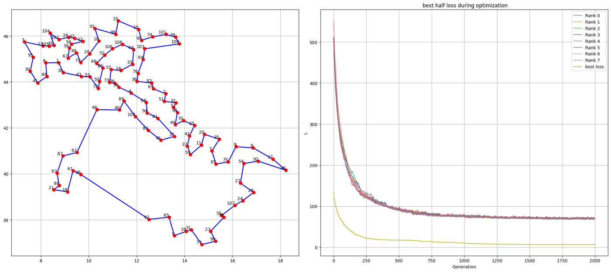
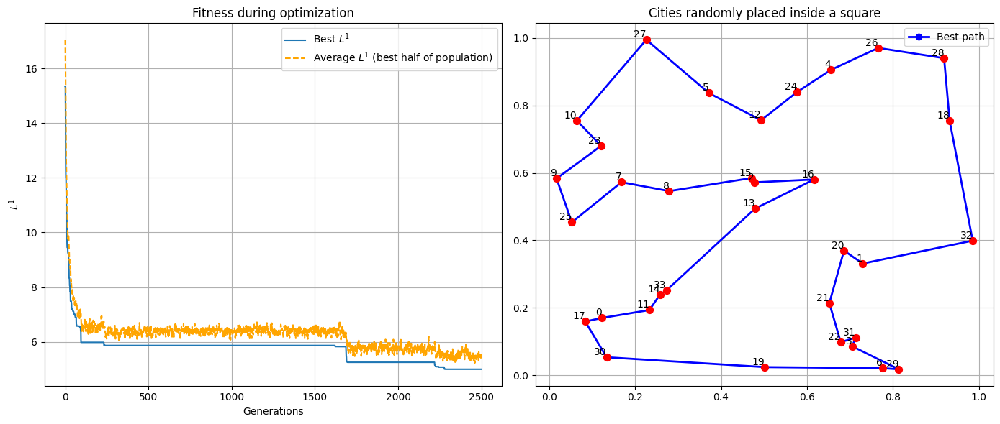

# Traveling salesman problem: genetic algorithm, ant colony and MPI

The traveling salesman problem (find the shortest closed path that visits N cities once) solved with metaheuristic algorithms written in C++: a genetic algorithm, an ant colony optimization, and a version of the genetic algorithm parallelized with MPI to find the shortest path through the 110 Italian provincial capitals.

The code was developed starting from the framework of the Numerical Simulation Laboratory course (prof. D.E. Galli, University of Milan), which provided the random number generator and the input data.



## Contents

**01_genetic_algorithm** - each path is a chromosome whose genes are the cities (the first city is fixed). The population evolves with selection (unfair roulette with elitism), crossover and several mutation operators (swaps, shifts, permutations and inversions of blocks of cities), always keeping the constraints of the problem. Tested on 34 cities randomly placed on a circumference, where the solution is known, and inside a square.

The `ACO` folder contains an ant colony optimization on the same problems: every ant builds a path choosing the next city with a probability that depends on the distance and on the pheromone left by the other ants, and the pheromones evaporate at each step.



**02_parallel_genetic_algorithm_mpi** - the genetic algorithm on the 110 Italian provincial capitals, parallelized with MPI as an island model: every process ("continent") evolves its own population, and every few generations pairs of continents exchange their best individuals. At the end the master collects the best paths of all the nodes. With 8 nodes the best path found has length 65.9 (plot at the top).

## Usage

The code needs [Armadillo](https://arma.sourceforge.net/), and the parallel version an MPI compiler.

```
cd 01_genetic_algorithm/SOURCE
make
./tsp 0      # cities on a circumference (1 for a square)

cd 02_parallel_genetic_algorithm_mpi/SOURCE
make
mpirun -np 8 ./tsp
```

The inputs are read from `../INPUT` and the results written in `../OUTPUT`, where the notebooks read them.
